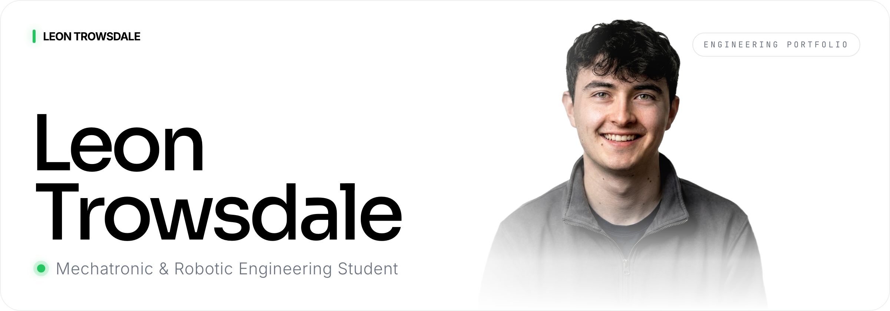

  

  <a href="https://leon-trowsdale-portfolio.pages.dev"><b>Portfolio</b></a>
  &nbsp;·&nbsp;
  <a href="https://linkedin.com/in/leon-trowsdale">LinkedIn</a>
  &nbsp;·&nbsp;
  <a href="https://leon-trowsdale-portfolio.pages.dev/Leon_Trowsdale_CV.pdf">CV</a>

 

I'm a Mechatronic & Robotic Engineering student at the **University of Birmingham**, currently working as an Engineering and Robotics Intern at **[Dexory](https://www.dexory.com)**. I'm in the Advanced Manufacturing department, developing systems to automate the manufacture and production of our robots.

 

## Experience

| Role | Company | Years |
| :-- | :-- | --: |
| **Engineering and Robotics Intern** | Dexory | `2026 — 2027` |
| **Lead Junior Educational Manager** | MyEdSpace | `2026 — Now` |
| **Junior Educational Manager** | MyEdSpace | `2025 — 2026` |
| **Technical Consultant** | Gillieron Scott Acoustic Design | `2023 — Now` |
| **Work Experience** | Cabinet Office | `2023` |

 

## Selected work

| Project | Summary |
| :-- | :-- |
| **[Automatic Dartboard](https://leon-trowsdale-portfolio.pages.dev/projects/automatic-dartboard)**  3D Printing / Autodarts · 2025 | A camera-based automatic scoring system: 97.6% accuracy over 14,774 throws. |
| **[LiPo Battery Safety Solution](https://leon-trowsdale-portfolio.pages.dev/projects/lipo-safety-solution)**  Product Design / 3D Printing · 2024 | A portable device that safely contains lithium battery fires during thermal runaway. |
| **[3D Printed Hovercraft](https://leon-trowsdale-portfolio.pages.dev/projects/3d-printed-hovercraft)**  3D Printing / RC · 2023 | Brushless motors and lightweight 3D printed structures. |
| **[Videography](https://leon-trowsdale-portfolio.pages.dev/projects/videography)**  Video · 2023 | Creative direction and post-production of cinematic projects. |

 

## Toolkit

`Fusion360` `3D Printing` `Arduino` `C` `Python` `Blender` `SketchUp` `MATLAB` `Unity` `Videography` `Music Production`

 

  © 2026 Leon Trowsdale

